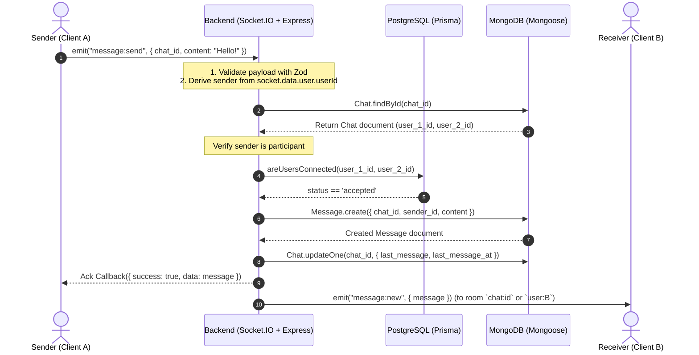
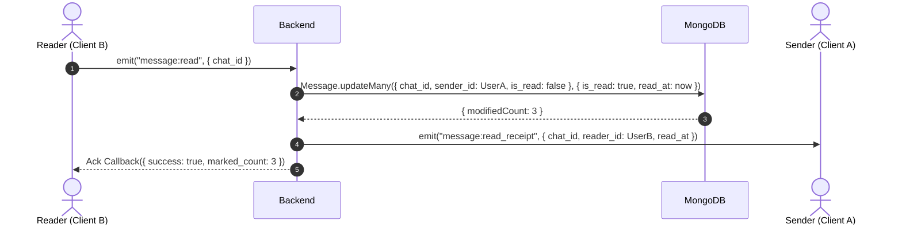

# UniLink Backend — Real-Time 1-to-1 Chat Feature Pre-Implementation Audit

**Document:** Comprehensive Architecture, Security, Database, and Real-Time Infrastructure Audit  
**Target Module:** 1-to-1 Real-Time Chat System  
**Audit Mode:** Static Read-Only Codebase Inspection  
**Location:** `backend/docs/CHAT_IMPLEMENTATION_AUDIT.md`  
**Date:** November 2026  
**Auditor:** Senior Backend Engineer & Software Architect  

---

## 1. Executive Summary

This audit assesses the architectural, operational, security, and performance readiness of the UniLink backend (`B:\Fall_Project\UniLink\backend`) for implementing a production-grade, 1-to-1 real-time chat system.

### Key Audit Conclusions

1. **Foundational Readiness:**
   - The backend exhibits a modern, clean foundation: **Node.js with TypeScript (`NodeNext` ESM)**, **Express 5.2.1**, **PostgreSQL via Prisma 7**, and **MongoDB via Mongoose 9.10.2**.
   - The project has already established robust conventions for dual-database orchestration in `src/modules/feed/` (MongoDB documents referencing PostgreSQL user UUIDs, application-level joins, and cursor-based pagination).
   - JWT authentication (`HS256`, 15-minute access tokens, database-backed refresh tokens) is cleanly implemented in `src/modules/auth/` and `src/middlewares/authmiddleware.ts`.

2. **Critical Architectural Gaps to Address Before Chat Implementation:**
   - **Socket.IO is Not Installed:** Neither `socket.io` nor `@types/socket.io` are present in `package.json`.
   - **HTTP Server Not Wrapped:** `src/server.ts` invokes `app.listen()` directly. Socket.IO requires an explicit Node.js `http.Server` instance (`http.createServer(app)`).
   - **No Graceful Shutdown:** `src/server.ts` lacks signal handlers (`SIGTERM`, `SIGINT`) to close HTTP listeners, terminate active Socket.IO connections, disconnect Prisma, and close Mongoose connections.
   - **Chat Models Out of Feature Module:** `Chat.ts` and `Message.ts` are located at `src/models/`, whereas the established module pattern (seen in `src/modules/feed/models/`) colocates Mongoose models inside the feature directory (`src/modules/chat/models/`).
   - **Chat Pre-Validate Hook Limitations:** `Chat.ts` normalizes user IDs in a Mongoose document `pre('validate')` hook. This hook runs only on document creation/save, **not** on queries like `Chat.findOne()` or `Chat.findOneAndUpdate()`. Normalization must be enforced in the service layer.
   - **Missing Unread Count Strategy and Indexes:** The current `Chat` schema does not track unread counts, and `Message` lacks an index covering `{ chat_id: 1, is_read: 1, sender_id: 1 }`, creating high latency and N+1 query risks when loading conversation lists.
   - **Prisma Connection Querying:** While a database-level unique index on `(LEAST(requester_id, receiver_id), GREATEST(requester_id, receiver_id))` exists in PostgreSQL migration `20260925145748_fix_connections`, Prisma's schema only exposes `@@index([receiverId])`. Connection verification must query bidirectionally (`OR: [{ requesterId: A, receiverId: B }, { requesterId: B, receiverId: A }]`) and verify `status: 'accepted'`.
   - **Flutter Client Still on Firestore:** The Flutter frontend currently implements chat via Firebase Firestore (`cloud_firestore`) in `lib/features/chat/`. A client-side migration will be required to interface with the backend's REST and Socket.IO endpoints.

3. **Implementation Viability:**
   - **High.** The backend architecture is well-suited for this feature. No complex distributed systems (e.g., Redis pub/sub) are required for the initial MVP scale. A modular `src/modules/chat/` design following the established `feed` module structure will yield a high-performance, maintainable solution.

---

## 2. Actual Inspected Repository Structure

### Directory Tree Overview

```text
B:\Fall_Project\UniLink\backend
├── .agents/
├── .claude/
├── .env                              # Local environment variables (untracked)
├── .env.example                      # Template environment variables
├── .gitignore
├── .windsurf/
├── CodeX/
│   └── BACKEND_FULL_REVIEW.md       # Pre-existing review (Oct 2026)
├── package.json                      # Dependencies & npm scripts
├── package-lock.json
├── prisma7.config.ts                 # Prisma 7 configuration file
├── tsconfig.json                     # TypeScript config (target: ES2022, module: NodeNext)
├── prisma/
│   ├── schema.prisma                 # PostgreSQL schema definition
│   └── migrations/
│       ├── 20260925124405_init/
│       ├── 20260925145748_fix_connections/  # Raw SQL: check constraint & functional unique index
│       ├── 20260928010826_default_role/
│       ├── 20260929201430_add_oauth/
│       └── 20260930164605_email_otp_and_emailverified/
└── src/
    ├── app.ts                        # Express application instance & global middleware
    ├── server.ts                     # Startup script & database connectivity checks
    ├── config/
    │   ├── env.ts                    # Environment variable parsing and validation
    │   ├── mongodb.ts                # Mongoose connection logic
    │   └── postgres.ts               # PrismaClient instance with pg adapter
    ├── middlewares/
    │   ├── authmiddleware.ts         # JWT Bearer token authentication & RBAC
    │   ├── errorMiddleware.ts        # Global Express error handler
    │   ├── rateLimiter.ts            # Rate limiting configuration (express-rate-limit)
    │   └── validation.ts             # Zod schema validation middleware
    ├── models/                       # Current top-level Mongoose schemas
    │   ├── Chat.ts                   # Existing Chat model (user_1_id, user_2_id)
    │   └── Message.ts                # Existing Message model (chat_id, sender_id, content)
    ├── modules/
    │   ├── auth/                     # Authentication & User Account feature
    │   │   ├── auth.controller.ts
    │   │   ├── auth.route.ts
    │   │   ├── auth.service.ts
    │   │   ├── oauth.service.ts
    │   │   ├── Otp.service.ts
    │   │   ├── Oauth.controller.ts
    │   │   └── validation/
    │   ├── feed/                     # Feed, Posts, Likes, Comments feature
    │   │   ├── feed.controller.ts
    │   │   ├── feed.route.ts
    │   │   ├── feed.service.ts
    │   │   ├── feed.validation.ts
    │   │   └── models/               # Colocated Mongoose models
    │   │       ├── Comment.ts
    │   │       ├── Like.ts
    │   │       └── Post.ts
    │   └── chat/                     # Pre-existing empty feature folder
    └── utils/
        ├── AppError.ts               # Custom operational error class
        ├── asyncHandler.ts           # Async wrapper (redundant in Express 5)
        ├── isMongoDuplicateKeyError.ts # Mongo error 11000 detection
        ├── jwt.ts                    # Access token signing helper
        ├── Mailer.ts                 # Nodemailer wrapper
        ├── Otp.ts                    # Crypto OTP generator
        ├── password.ts               # Bcrypt password hashing & comparison
        ├── refreshToken.ts           # Crypto random token & sha256 hashing
        └── types/
            └── express.d.ts          # Global Express Request typing (user, validated)
```

---

## 3. Existing Architecture and Conventions

### 3.1 Module System and TypeScript Configuration
- **Module Format:** Modern ECMAScript Modules (`"type": "module"` in `package.json`).
- **Module Resolution:** `NodeNext` targeting `ES2022` (`tsconfig.json`).
- **Import Requirement:** All internal relative imports **must explicitly include the `.js` file extension** (e.g., `import prisma from "../../config/postgres.js";`). Omitting `.js` results in compile/runtime failures under `NodeNext`.
- **Package Scripts:**
  - `npm run dev`: Executes via `tsx watch src/server.ts` (supports TypeScript natively during development).
  - `npm run build`: Executes `tsc` to produce output in `dist/`.
  - `npm start`: Executes `node dist/server.js`.

### 3.2 Framework and Middleware Stack
- **Express Version:** `5.2.1`. Express 5 natively catches unhandled promise rejections in route handlers and passes them to the error middleware without requiring an `asyncHandler` wrapper.
- **Global Middleware Sequence (`src/app.ts`):**
  1. `helmet()` for basic security headers.
  2. `cors()` configured with permissive defaults (`origin: *`).
  3. `express.json()` for parsing JSON payloads.
  4. `morgan("dev")` for HTTP request logging.
  5. Route mounts: `/api/v1/auth`, `/api/v1/feed`.
  6. 404 handler (`Route not found`).
  7. `errorMiddleware` as the final error handler.

### 3.3 Error Handling Conventions
- **Operational Errors:** Handled via the custom `AppError` class (`src/utils/AppError.ts`), taking `(message: string, statusCode: number)`.
- **Central Handler (`src/middlewares/errorMiddleware.ts`):**
  - Catches `AppError` and outputs `{ success: false, message: err.message }` with `err.statusCode`.
  - Catches `ZodError` and outputs HTTP 400 with `{ success: false, message: "Validation error", errors: err.issues }`.
  - Catches `mongoose.Error.CastError` and outputs HTTP 400 (`Invalid identifier`).
  - Catches `mongoose.Error.ValidationError` and outputs HTTP 400 (`Validation error`).
  - Catches Body-parser errors (400, 413).
  - Fallback catches unhandled errors with HTTP 500 (`Internal server error`) and logs to `console.error`.

### 3.4 Request Validation Approach
- **Library:** Zod (`^4.6.5`).
- **Middleware:** `validate(schema, target)` where `target` is `"body" | "query" | "params"`.
- **Behavior:**
  - If `target === "body"`, sanitized/parsed data replaces `req.body`.
  - If `target === "query"` or `"params"`, parsed data is attached to `req.validated.query` or `req.validated.params`.
  - Typing is augmented globally via `src/utils/types/express.d.ts`.

### 3.5 Database Access & Dual-Database Orchestration
- **Relational Domain (PostgreSQL via Prisma 7):**
  - Manages relational entities: Users, Roles, Refresh Tokens, Connections, Jobs, Applications, Follows.
  - Initialized with `@prisma/adapter-pg` over native `pg` connection pool (`src/config/postgres.ts`).
- **Document Domain (MongoDB via Mongoose 9.10.2):**
  - Manages high-velocity, polymorphic, or social graph entities: Posts, Likes, Comments, Chats, Messages.
- **Cross-Database Linking Pattern (from `feed.service.ts`):**
  1. Primary query runs against MongoDB (e.g., retrieving posts or messages).
  2. Foreign references (e.g., `author_id`, `sender_id`, `user_1_id`) are stored as PostgreSQL user UUID strings.
  3. The service layer extracts unique UUIDs from the MongoDB result set.
  4. A batch query is executed against PostgreSQL using Prisma:
     ```typescript
     const users = await prisma.user.findMany({
       where: { id: { in: userIds }, deletedAt: null },
       select: { id: true, fullName: true, photoUrl: true, isOnline: true, lastSeen: true }
     });
     ```
  5. The service layer hydrates the MongoDB documents with the relational user profiles in memory before returning the response to the client.
- **Pagination Pattern (from `feed.service.ts`):**
  - Deterministic cursor-based pagination using compound `(created_at, _id)`.
  - Cursor is encoded as a URL-safe Base64 string: `${created_at.toISOString()}|${_id}`.
  - Decoded using `$or` filtering:
    ```typescript
    {
      $or: [
        { created_at: { $lt: cursorDate } },
        { created_at: cursorDate, _id: { $lt: cursorId } }
      ]
    }
    ```
  - Fetch limit: `limit + 1` to check for `hasMore`.

---

## 4. Existing Chat and Message Model Review

### 4.1 Chat Model (`src/models/Chat.ts`)

```typescript
export interface IChat {
  user_1_id: string;
  user_2_id: string;
  last_message: string | null;
  last_message_sender_id: string | null;
  last_message_at: Date | null;
  created_at: Date;
  updated_at: Date;
}
```

#### Detailed Findings & Architectural Vulnerabilities:
1. **User Pair Normalization via `pre('validate')` Hook:**
   - The schema defines:
     ```typescript
     chatSchema.pre('validate', function () {
       if (!this.user_1_id || !this.user_2_id) return;
       if (this.user_1_id === this.user_2_id) throw new Error('A user cannot create a chat with themselves');
       if (this.user_1_id > this.user_2_id) {
         [this.user_1_id, this.user_2_id] = [this.user_2_id, this.user_1_id];
       }
     });
     ```
   - **Vulnerability / Gotcha:** In Mongoose, `pre('validate')` is a **document middleware** that triggers only when an instance is instantiated and validated (e.g., `new Chat().save()`).
   - It **does not run** on query middleware such as `Chat.findOne()`, `Chat.findOneAndUpdate()`, or `Chat.countDocuments()`.
   - If a query is issued as `Chat.findOne({ user_1_id: idB, user_2_id: idA })` where `idB > idA`, the query will return `null` even if the conversation exists!
   - Furthermore, if `findOneAndUpdate(..., { upsert: true })` were used without manual normalization, it would bypass `pre('validate')` and create a duplicate inverted conversation record!
   - **Remedy:** A dedicated helper function `normalizeUserPair(userA: string, userB: string): [string, string]` must be defined and strictly invoked by the service layer **prior** to any MongoDB read, write, or update operation.
2. **Duplicate Prevention Index:**
   - `chatSchema.index({ user_1_id: 1, user_2_id: 1 }, { unique: true });`
   - This index reliably guarantees that only one conversation thread can exist between two users, provided user pairs are always inserted in lexicographical order.
3. **List Sorting & Null Handling:**
   - Existing indexes:
     - `chatSchema.index({ user_1_id: 1, last_message_at: -1 });`
     - `chatSchema.index({ user_2_id: 1, last_message_at: -1 });`
   - When a conversation is brand new, `last_message_at` is initialized to `null`.
   - In MongoDB BSON type ordering, `null` sorts lowest. In a descending (`-1`) sort, conversations with `null` will sort at the very end of the list.
   - For active chats, MongoDB can utilize either index when querying `{ $or: [{ user_1_id: userId }, { user_2_id: userId }] }`.
4. **Missing Unread Message Counters:**
   - The current `Chat` schema has no fields for unread counts (e.g., `unread_count_user_1` and `unread_count_user_2`).
   - Without denormalized unread counters or an optimized index on `Message`, retrieving a list of conversations requires either an aggregation pipeline or N queries against the `Message` collection.

### 4.2 Message Model (`src/models/Message.ts`)

```typescript
export interface IMessage {
  chat_id: Types.ObjectId;
  sender_id: string; // app-level ref -> PostgreSQL users.id
  content: string;
  is_read: boolean;
  read_at: Date | null;
  created_at: Date;
  updated_at: Date;
}
```

#### Detailed Findings & Architectural Vulnerabilities:
1. **Content Validation:**
   - `content: { type: String, required: true, maxlength: 2000 }`
   - Missing `trim: true`. Without `trim: true`, a string of 2000 spaces passes Mongoose validation. Service layer and Zod validation must enforce non-empty trimmed strings.
2. **Deterministic Cursor Index:**
   - `messageSchema.index({ chat_id: 1, created_at: -1, _id: -1 });`
   - This compound index aligns perfectly with the cursor pagination design used in `feed.service.ts`, allowing rapid backward traversal through chat history without offset-based performance degradation.
3. **Missing Index for Read Receipts and Unread Counts:**
   - When marking messages as read:
     ```typescript
     Message.updateMany(
       { chat_id: chatId, sender_id: { $ne: viewerId }, is_read: false },
       { $set: { is_read: true, read_at: new Date() } }
     );
     ```
   - When counting unread messages:
     ```typescript
     Message.countDocuments({ chat_id: chatId, sender_id: { $ne: viewerId }, is_read: false });
     ```
   - With only `{ chat_id: 1, created_at: -1, _id: -1 }`, MongoDB must inspect index keys and filter out read messages.
   - **Recommended Compound Index:**
     ```typescript
     messageSchema.index({ chat_id: 1, is_read: 1, sender_id: 1 });
     ```
4. **Chat-Message Data Synchronization & Race Conditions:**
   - When a new message is saved, the parent `Chat` must be updated with `last_message`, `last_message_sender_id`, and `last_message_at`.
   - **Race Condition Risk:** If two messages are dispatched concurrently (Message 1 at T1, Message 2 at T2 where T2 > T1), network or execution jitter could cause Message 1's update to execute after Message 2's update, overwriting `last_message` with stale text.
   - **Mitigation:** Use a conditional atomic update:
     ```typescript
     await Chat.updateOne(
       {
         _id: chatId,
         $or: [
           { last_message_at: { $lte: message.created_at } },
           { last_message_at: null }
         ]
       },
       {
         $set: {
           last_message: message.content,
           last_message_sender_id: message.sender_id,
           last_message_at: message.created_at,
         }
       }
     );
     ```

---

## 5. Authentication and Authorization

### 5.1 Existing Authentication Mechanism
- **Tokens Issued (`src/modules/auth/auth.service.ts`):**
  - **Access Token:** Stateless JWT signed with `HS256`, containing `{ userId: string, role: Role }`. Expiry configured by `JWT_ACCESS_EXPIRES_IN` (default: `15m`).
  - **Refresh Token:** High-entropy random hex string (`crypto.randomBytes(64).toString('hex')`). Stored in PostgreSQL `refresh_tokens` table as a SHA-256 hash with an expiration timestamp (`expires_at`, default: 7 days).
- **HTTP Verification Middleware (`src/middlewares/authmiddleware.ts`):**
  - Extracts `Bearer <token>` from the HTTP `Authorization` header.
  - Verifies token using `jwt.verify(token, env.jwtSecret, { algorithms: ["HS256"] })`.
  - Type-guards payload via `isAuthTokenPayload`.
  - Attaches authenticated user to `req.user = { userId, role }`.

### 5.2 Reusing Authentication for Socket.IO
To prevent code duplication, the token verification logic in `authmiddleware.ts` should be factored into a shared utility function:

```typescript
// Shared token verification utility
export const verifyTokenPayload = (token: string): AuthTokenPayload => {
  const payload = jwt.verify(token, env.jwtSecret, { algorithms: ["HS256"] });
  if (!isAuthTokenPayload(payload)) {
    throw new AppError("Invalid token payload", 401);
  }
  return payload;
};
```

#### Socket.IO Connection Middleware:
```typescript
io.use((socket, next) => {
  try {
    const authHeader = socket.handshake.headers.authorization;
    const token =
      socket.handshake.auth?.token ||
      (authHeader?.startsWith("Bearer ") ? authHeader.slice(7).trim() : null);

    if (!token) {
      return next(new Error("Authentication error: Token missing"));
    }

    const payload = verifyTokenPayload(token);
    socket.data.user = payload; // Attach userId and role to socket session
    next();
  } catch (error) {
    next(new Error("Authentication error: Invalid or expired token"));
  }
});
```

### 5.3 Token Expiration and Revocation Risks in Long-Lived WebSockets
- **The Problem:** In HTTP REST requests, an expired access token fails immediately on the next request. In WebSockets, the handshake occurs once. If a client maintains a connection for 6 hours, the initial 15-minute token expires 15 minutes in, but the socket remains open.
- **Security Risks:**
  1. A user logs out on their device (revoking their refresh token in PostgreSQL), but an active socket connection continues to send and receive messages.
  2. A user is deleted or banned, but their open socket remains authorized.
  3. A connection between User A and User B is removed, but active sockets continue communicating.
- **Recommended Mitigations:**
  1. **Strict Identity Derivation:** Never accept `senderId` from socket payloads. Always bind outgoing messages to `socket.data.user.userId`.
  2. **Per-Action Authorization Check:** When `message:send` or `chat:join` is emitted, verify the participant relationship and active connection status against the database.
  3. **Periodic Re-Authentication / Socket Lifespan:** Instruct the client to refresh tokens and emit an `auth:refresh` socket event, or disconnect sockets after a fixed maximum duration (e.g., 2 hours) forcing a reconnection with a fresh access token.
  4. **Account State Invalidation:** When an account is deleted or a refresh token revoked, broadcast an administrative disconnect event to the specific user's private room (`user:${userId}`).

---

## 6. PostgreSQL and Prisma Relationship Review

### 6.1 Schema Models Inspected (`backend/prisma/schema.prisma`)

#### `User` Model:
- Primary key: `id String @id @default(uuid()) @db.Uuid`.
- Fields: `email`, `fullName`, `role` (`student` | `recruiter`), `isOnline` (`Boolean @default(false)`), `lastSeen` (`DateTime?`), `deletedAt` (`DateTime?`).
- **Presence Tracking:** `isOnline` and `lastSeen` directly exist on `User`.
- **Soft Deletion:** Any user with `deletedAt !== null` is deactivated and must be blocked from sending/receiving chat messages.

#### `Connection` Model:
```prisma
model Connection {
  id            String           @id @default(uuid()) @db.Uuid
  requesterId   String           @map("requester_id") @db.Uuid
  receiverId    String           @map("receiver_id") @db.Uuid
  status        ConnectionStatus @default(pending)
  createdAt     DateTime         @default(now()) @map("created_at")
  updatedAt     DateTime         @updatedAt @map("updated_at")

  requester User @relation("ConnectionRequester", fields: [requesterId], references: [id])
  receiver  User @relation("ConnectionReceiver", fields: [receiverId], references: [id])

  @@index([receiverId])
  @@map("connections")
}
```

### 6.2 Raw Migration Index vs Prisma Schema
Inspection of migration `20260925145748_fix_connections/migration.sql` reveals critical database constraints not expressed in `schema.prisma`:
```sql
-- Prevent users from connecting to themselves
ALTER TABLE "connections"
ADD CONSTRAINT "connections_users_different"
CHECK ("requester_id" <> "receiver_id");

-- Prevent duplicate active connections regardless of direction
CREATE UNIQUE INDEX "connections_pair_idx"
ON "connections" (
    LEAST("requester_id", "receiver_id"),
    GREATEST("requester_id", "receiver_id")
)
WHERE "status" <> 'rejected'
  AND "status" <> 'removed';
```

#### Implications:
1. PostgreSQL **enforces at the database engine level** that no duplicate active connections can exist between any pair of users, regardless of who is the requester or receiver.
2. In the Prisma schema, only `@@index([receiverId])` is defined. Prisma is unaware of the partial functional unique index `connections_pair_idx`.
3. To safely check if User A and User B are permitted to chat, the query must check both directions and verify `status: 'accepted'`:

```typescript
export const areUsersConnected = async (userA: string, userB: string): Promise<boolean> => {
  const connection = await prisma.connection.findFirst({
    where: {
      OR: [
        { requesterId: userA, receiverId: userB },
        { requesterId: userB, receiverId: userA },
      ],
      status: "accepted",
    },
    select: { id: true },
  });

  return Boolean(connection);
};
```

### 6.3 Query Optimization Recommendation
- `requesterId` currently lacks a standalone index in Prisma.
- For maximum query performance at scale, the following index should be added to `Connection` in a future migration:
  ```prisma
  @@index([requesterId, receiverId, status])
  ```
  *(Audit constraint: no schema changes during this phase; documented for Phase 1/Phase 2 implementation).*

---

## 7. MongoDB Review

### 7.1 Connection Lifecycle (`src/config/mongodb.ts`)
```typescript
const connectMongoDB = async (): Promise<void> => {
  try {
    await mongoose.connect(env.mongodbUri);
    console.log('MongoDB connected successfully');
  } catch (error) {
    const message = error instanceof Error ? error.message : String(error);
    console.error('MongoDB connection failed:', message);
    process.exit(1);
  }
};
```

### 7.2 Deficiencies in Current MongoDB Setup
1. **No Connection Pool Configuration:** Default connection pool settings are used. For real-time chat workloads with concurrent message writes, it is recommended to explicitly set `maxPoolSize: 50` and `minPoolSize: 10`.
2. **Missing Runtime Event Handlers:** No listeners for `disconnected`, `reconnected`, or `error` events on `mongoose.connection`. If MongoDB drops under load, Socket.IO handlers will reject without structured logging.
3. **Model Placement Inconsistency:** `Post`, `Like`, and `Comment` are stored in `src/modules/feed/models/`. `Chat` and `Message` are currently in `src/models/`. For architectural uniformity, chat models should reside within `src/modules/chat/models/`.

---

## 8. Express and Server Lifecycle

### 8.1 Current `server.ts` Architecture
```typescript
// Current server.ts
const startServer = async (): Promise<void> => {
  try {
    await prisma.$queryRaw`SELECT 1`;
    console.log('PostgreSQL connected successfully');

    await connectMongoDB();

    app.listen(env.port, () => {
      console.log(`UniLink Backend running on port ${env.port}`);
    });
  } catch (error) {
    ...
  }
};
```

### 8.2 Socket.IO Integration Plan
Socket.IO requires access to the underlying Node.js HTTP server.

```typescript
import http from 'node:http';
import { Server as SocketIOServer } from 'socket.io';
import app from './app.js';
import env from './config/env.js';
import connectMongoDB from './config/mongodb.js';
import prisma from './config/postgres.js';
import { setupChatSocket } from './modules/chat/chat.socket.js';

const startServer = async (): Promise<void> => {
  try {
    await prisma.$queryRaw`SELECT 1`;
    console.log('PostgreSQL connected successfully');

    await connectMongoDB();

    // 1. Create native HTTP server wrapping Express
    const httpServer = http.createServer(app);

    // 2. Initialize Socket.IO attached to HTTP server
    const io = new SocketIOServer(httpServer, {
      cors: {
        origin: '*', // Align with app CORS or configure exact client origins
        methods: ['GET', 'POST'],
      },
      pingInterval: 25000,
      pingTimeout: 20000,
    });

    // 3. Register Socket.IO handlers
    setupChatSocket(io);

    // 4. Start HTTP Server
    httpServer.listen(env.port, () => {
      console.log(`UniLink Backend running on port ${env.port}`);
    });

    // 5. Graceful Shutdown Registration
    const handleShutdown = async (signal: string) => {
      console.log(`Received ${signal}. Initiating graceful shutdown...`);

      // Close Socket.IO server (disconnects clients)
      io.close(() => console.log('Socket.IO server closed.'));

      // Close HTTP server (stops accepting new connections)
      httpServer.close(async () => {
        console.log('HTTP server closed.');

        // Disconnect Prisma
        await prisma.$disconnect();
        console.log('PostgreSQL disconnected.');

        // Close MongoDB
        await mongoose.connection.close(false);
        console.log('MongoDB disconnected.');

        process.exit(0);
      });
    };

    process.on('SIGTERM', () => handleShutdown('SIGTERM'));
    process.on('SIGINT', () => handleShutdown('SIGINT'));

  } catch (error) {
    console.error('Server startup failed:', error);
    process.exit(1);
  }
};
```

---

## 9. Flutter / Frontend Integration Findings

### 9.1 Existing Frontend Implementation Inspection
- **Location:** `lib/features/chat/`
- **Data Source:** `lib/features/chat/data/chat_remote_datasource.dart`
- **Presentation Pages:**
  - `lib/features/chat/presentation/pages/chat_list_page.dart`
  - `lib/features/chat/presentation/pages/chat_detail_page.dart`
- **Security Rules:** `firestore.rules` lines 80–93 (`match /chats/{chatId}`).

### 9.2 Key Findings from Frontend Analysis
1. **Firestore Reliance:** The existing Flutter app directly queries Firebase Firestore (`cloud_firestore`) and Firebase Authentication (`firebase_auth`).
2. **Firestore Contract Schemas:**
   - **Thread ID Format:** In Firestore, the thread ID is generated deterministically as `${sorted[0]}_${sorted[1]}` (e.g., `uidA_uidB`).
   - **Thread Fields:** `participantIds`, `participantNames`, `lastMessageText`, `lastMessageAt`, `lastSenderId`.
   - **Message Fields:** `id`, `text`, `senderId`, `createdAt`, `read`.
3. **Backend Transition Strategy:**
   - The UniLink backend uses MongoDB ObjectIds (`_id`) for Chat and Message documents, and PostgreSQL UUIDs for User entities.
   - The REST and Socket.IO API responses must provide clean mappings (`id`, `otherUser`, `lastMessage`, `createdAt`, `isRead`, etc.) that align with Flutter's domain entities.
   - Flutter will replace `ChatRemoteDataSourceImpl` with an HTTP/Socket.IO data source (`socket_io_client` + `http`).

---

## 10. Security Review

| Risk ID | Vulnerability / Attack Vector | Severity | Recommended Mitigation |
|:---|:---|:---:|:---|
| **SEC-01** | **Unauthorized Conversation Access (IDOR)**<br>A user queries `/api/v1/chats/:chatId` for a chat they are not part of. | **High** | In service/middleware, verify that `req.user.userId === chat.user_1_id || req.user.userId === chat.user_2_id`. Return 403 Forbidden otherwise. |
| **SEC-02** | **Chatting Without Accepted Connection**<br>Users bypass UI and attempt to create conversations or send messages to arbitrary users. | **High** | In `createChat` and `sendMessage`, perform a mandatory PostgreSQL check: `areUsersConnected(userA, userB)`. If `status !== 'accepted'`, reject with 403. |
| **SEC-03** | **Sender ID Forgery in Socket.IO**<br>Client sends `{ senderId: "victim-uuid", text: "..." }` over socket event. | **High** | Never read `senderId` from payload. Derive sender exclusively from `socket.data.user.userId` established during authenticated handshake. |
| **SEC-04** | **Unauthorized Socket Room Subscription**<br>Client emits `chat:join` with arbitrary `chatId`. | **High** | Before calling `socket.join(chatId)`, fetch `Chat` document and verify `socket.data.user.userId` is one of the two participants. |
| **SEC-05** | **Interacting with Soft-Deleted Users**<br>User initiates chat with an account whose `deletedAt` is set. | **Medium** | During conversation creation and message sending, verify both participants have `deletedAt: null` in PostgreSQL. |
| **SEC-06** | **Excessive Message Length / Payload Injection**<br>Client transmits massive text payloads to degrade server memory or crash database. | **Medium** | Validate payloads with Zod (`z.string().trim().min(1).max(2000)`) on both REST endpoints and Socket.IO event listeners. |
| **SEC-07** | **Chat Spam / Flooding**<br>Scripted socket connections emit hundreds of messages per second. | **Medium** | Implement per-socket rate limiting (e.g., token bucket or sliding window limiting users to 5 messages per second). |
| **SEC-08** | **Replay / Stale Access Tokens on Sockets**<br>Token expires 15m after connect, socket remains connected for hours after logout. | **Medium** | Tag active sockets in user rooms. On logout/revocation in Auth module, emit administrative disconnect to `user:${userId}` room. |
| **SEC-09** | **CORS Permissiveness**<br>`src/app.ts` uses open CORS (`cors()`). | **Low** | Restrict allowed origins to verified web/mobile domains in production environment configuration. |
| **SEC-10** | **MongoDB Query Injection**<br>Unsanitized inputs used directly in `$or` or `find` filters. | **Low** | Use Zod schemas with regex/refine checks validating string formats as valid UUIDs and MongoDB ObjectIds. |

---

## 11. Performance and Scalability

### 11.1 Index Optimization Matrix
- **`Chat` Collection:**
  - `{ user_1_id: 1, user_2_id: 1 }` (Unique): Prevents duplicates, fast 1-to-1 thread lookup.
  - `{ user_1_id: 1, last_message_at: -1 }`: Fast retrieval of user conversations sorted by recency.
  - `{ user_2_id: 1, last_message_at: -1 }`: Fast retrieval of user conversations sorted by recency.
- **`Message` Collection:**
  - `{ chat_id: 1, created_at: -1, _id: -1 }`: Deterministic cursor pagination, reverse chronological order.
  - `{ chat_id: 1, is_read: 1, sender_id: 1 }` *(New recommended index)*: Accelerates unread count queries and bulk read receipt updates from $O(N)$ message scans to $O(K)$ matching index seeks.

### 11.2 N+1 Query Elimination in Conversation Lists
When retrieving the conversation list (`GET /api/v1/chats`):
1. Retrieve up to `limit` chat documents from MongoDB for `userId` (where `user_1_id == userId || user_2_id == userId`).
2. Extract the partner user ID from each conversation: `partnerId = (chat.user_1_id === userId ? chat.user_2_id : chat.user_1_id)`.
3. In a single batch query, fetch all partner profiles from PostgreSQL:
   ```typescript
   const partners = await prisma.user.findMany({
     where: { id: { in: partnerIds } },
     select: { id: true, fullName: true, photoUrl: true, isOnline: true, lastSeen: true }
   });
   ```
4. Merge in memory. **Total queries:** 1 MongoDB query + 1 PostgreSQL query. Zero N+1 latency.

### 11.3 Online/Offline Presence Optimization
- Updating PostgreSQL on every socket connect/disconnect could cause database thrashing if a user opens/refreshes multiple browser tabs or apps simultaneously.
- **Solution:** Room-based socket counting:
  ```typescript
  // On connect
  const sockets = await io.in(`user:${userId}`).fetchSockets();
  if (sockets.length === 1) {
    // First connection: update DB to online
    await prisma.user.update({ where: { id: userId }, data: { isOnline: true } });
  }

  // On disconnect
  const remaining = await io.in(`user:${userId}`).fetchSockets();
  if (remaining.length === 0) {
    // Last connection closed: update DB to offline
    await prisma.user.update({
      where: { id: userId },
      data: { isOnline: false, lastSeen: new Date() }
    });
  }
  ```

---

## 12. Proposed Chat Module Structure

To maintain strict adherence to the backend's modular architecture, all chat components should reside in `src/modules/chat/`:

```text
src/modules/chat/
├── chat.controller.ts      # HTTP request handlers for REST endpoints
├── chat.route.ts           # Express router definitions & middleware binding
├── chat.service.ts         # Core business logic, dual-DB coordination, validation
├── chat.validation.ts      # Zod validation schemas for params, queries, and bodies
├── chat.socket.ts          # Socket.IO connection handling, event routing, real-time logic
├── chat.types.ts           # TypeScript interfaces and Socket event contracts
└── models/                 # Colocated Mongoose models (aligning with feed module)
    ├── Chat.ts             # Chat schema, indexes, and normalization logic
    └── Message.ts          # Message schema, indexes, and pagination support
```

### Component Responsibilities:
1. **`models/Chat.ts` & `models/Message.ts`:**
   - Define data schemas, constraints, and indexes. Re-exported or moved from `src/models/` to encapsulate the domain.
2. **`chat.validation.ts`:**
   - Validates input formats (`chatId` as Mongo ObjectId, `otherUserId` as UUID, `limit`, `cursor`, `content` max 2000 chars).
3. **`chat.service.ts`:**
   - Validates connection status via Prisma.
   - Normalizes user pairs (`userA < userB ? [userA, userB] : [userB, userA]`).
   - Executes MongoDB queries and mutations.
   - Batches PostgreSQL user profile lookups.
   - Cursor encoding and decoding (`encodeCursor`, `decodeCursor`).
4. **`chat.controller.ts`:**
   - Unpacks `req.user`, `req.validated`, delegates to `chat.service.ts`, returns standard `{ success: true, data }` responses.
5. **`chat.route.ts`:**
   - Defines REST endpoints, protects routes with `authMiddleware()`, applies `validate()` middleware.
6. **`chat.socket.ts`:**
   - Handles Socket.IO authentication, room management, real-time message broadcasting, read receipts, and presence updates.

---

## 13. REST API Specification

All endpoints require `Authorization: Bearer <access_token>`.

### 13.1 `POST /api/v1/chats`
**Description:** Get or initialize a 1-to-1 conversation with a connected user. Idempotent: returns existing chat if already created.
- **Request Body:**
  ```json
  {
    "other_user_id": "3fa85f64-5717-4562-b3fc-2c963f66afa6"
  }
  ```
- **Validation:** `other_user_id` must be valid UUID and not equal to caller.
- **Business Rule:** Caller and `other_user_id` must have an `accepted` connection in PostgreSQL.
- **Success Response (200 / 201):**
  ```json
  {
    "success": true,
    "data": {
      "id": "672661849204910248201a01",
      "other_user": {
        "id": "3fa85f64-5717-4562-b3fc-2c963f66afa6",
        "full_name": "Jane Doe",
        "photo_url": "https://example.com/avatar.jpg",
        "is_online": true,
        "last_seen": "2026-11-02T14:30:00.000Z"
      },
      "last_message": null,
      "last_message_at": null,
      "last_message_sender_id": null,
      "unread_count": 0,
      "created_at": "2026-11-02T14:40:00.000Z"
    }
  }
  ```
- **Error Responses:**
  - `400 Bad Request`: Validation error or self-chat attempt.
  - `403 Forbidden`: Users are not connected or account is deleted.
  - `404 Not Found`: Partner user does not exist.

### 13.2 `GET /api/v1/chats`
**Description:** Retrieve paginated list of conversations for the authenticated user, ordered by `last_message_at` descending.
- **Query Parameters:**
  - `limit` (optional, default: 20, max: 50)
  - `cursor` (optional, Base64 cursor string)
- **Success Response (200):**
  ```json
  {
    "success": true,
    "data": {
      "chats": [
        {
          "id": "672661849204910248201a01",
          "other_user": {
            "id": "3fa85f64-5717-4562-b3fc-2c963f66afa6",
            "full_name": "Jane Doe",
            "photo_url": "https://example.com/avatar.jpg",
            "is_online": true,
            "last_seen": "2026-11-02T14:30:00.000Z"
          },
          "last_message": "Hey, how are you?",
          "last_message_at": "2026-11-02T14:45:00.000Z",
          "last_message_sender_id": "3fa85f64-5717-4562-b3fc-2c963f66afa6",
          "unread_count": 2,
          "created_at": "2026-11-02T14:40:00.000Z"
        }
      ],
      "next_cursor": "MjAyNi0xMS0wMlQxNDo0NTowMC4wMDBafDY3MjY2MTg0OTIwNDkxMDI0ODIwMWEwMQ==",
      "has_more": false
    }
  }
  ```

### 13.3 `GET /api/v1/chats/:chatId`
**Description:** Retrieve single conversation metadata.
- **URL Parameters:** `chatId` (24-hex-char MongoDB ObjectId).
- **Authorization:** Caller must be a participant.
- **Success Response (200):** Details of the single chat.

### 13.4 `GET /api/v1/chats/:chatId/messages`
**Description:** Retrieve paginated messages for a conversation, newest first (or chronological based on cursor).
- **URL Parameters:** `chatId`
- **Query Parameters:**
  - `limit` (optional, default: 30, max: 100)
  - `cursor` (optional, Base64 compound cursor `${created_at}|${_id}`)
- **Success Response (200):**
  ```json
  {
    "success": true,
    "data": {
      "messages": [
        {
          "id": "672661849204910248201b99",
          "chat_id": "672661849204910248201a01",
          "sender_id": "3fa85f64-5717-4562-b3fc-2c963f66afa6",
          "content": "Hey, how are you?",
          "is_read": true,
          "read_at": "2026-11-02T14:46:10.000Z",
          "created_at": "2026-11-02T14:45:00.000Z"
        }
      ],
      "next_cursor": "MjAyNi0xMS0wMlQxNDo0NTowMC4wMDBafDY3MjY2MTg0OTIwNDkxMDI0ODIwMWI5OQ==",
      "has_more": true
    }
  }
  ```

### 13.5 `POST /api/v1/chats/:chatId/messages`
**Description:** Send a message via REST API (fallback for non-socket clients).
- **Request Body:**
  ```json
  {
    "content": "Hello world!"
  }
  ```
- **Success Response (201):** The created message object. Side effect: broadcasts `message:new` event over Socket.IO to room `chat:${chatId}`.

### 13.6 `PATCH /api/v1/chats/:chatId/read`
**Description:** Mark all incoming unread messages in the chat as read.
- **Success Response (200):**
  ```json
  {
    "success": true,
    "data": {
      "marked_count": 3,
      "read_at": "2026-11-02T14:50:00.000Z"
    }
  }
  ```
  *(Side effect: broadcasts `message:read_receipt` over Socket.IO to room `chat:${chatId}`)*.

---

## 14. Socket.IO Event Specification

### 14.1 Connection & Handshake
- **Handshake Auth:**
  ```javascript
  const socket = io("http://localhost:5000", {
    auth: {
      token: "eyJhbGciOiJIUzI1NiIsInR5cCI6IkpXVCJ9..."
    }
  });
  ```
- **On Connection:**
  - Socket joins user-specific room: `user:${socket.data.user.userId}`.
  - Presence transition check: if `io.in(userRoom).fetchSockets().length === 1`, update `User.isOnline = true` in PostgreSQL.

### 14.2 Client to Server (C2S) Events

| Event Name | Payload Schema | Acknowledgement Callback | Behavior |
|:---|:---|:---|:---|
| `chat:join` | `{ "chat_id": string }` | `(res: { success: boolean, error?: string }) => void` | Verifies user is participant of `chat_id`. On success, calls `socket.join("chat:" + chat_id)`. |
| `chat:leave` | `{ "chat_id": string }` | `(res: { success: boolean }) => void` | Calls `socket.leave("chat:" + chat_id)`. |
| `message:send` | `{ "chat_id": string, "content": string, "temp_id"?: string }` | `(res: { success: boolean, data?: MessageDTO, error?: string }) => void` | Validates content length (1–2000), checks connection status, persists message, updates Chat, broadcasts to room. |
| `message:read` | `{ "chat_id": string }` | `(res: { success: boolean, marked_count?: number }) => void` | Updates unread messages where `sender_id !== userId`, broadcasts read receipt event. |

### 14.3 Server to Client (S2C) Events

| Event Name | Target Room / Recipient | Payload Schema | Description |
|:---|:---|:---|:---|
| `message:new` | `chat:${chat_id}` + `user:${receiver_id}` | `{ "message": MessageDTO, "temp_id"?: string }` | Broadcast immediately when message is stored. |
| `message:read_receipt` | `chat:${chat_id}` | `{ "chat_id": string, "reader_id": string, "read_at": string }` | Notifies sender that messages have been read. |
| `user:presence` | Connected user contacts | `{ "user_id": string, "is_online": boolean, "last_seen": string }` | Emitted when a contact transitions online or offline. |
| `error` | Current socket | `{ "code": string, "message": string }` | Emitted on unhandled or operational socket errors. |

---

## 15. Database and Data-Flow Design

### 15.1 Real-Time Message Dispatch Flow



### 15.2 Read Receipt Flow



---

## 16. Risks and Unresolved Questions

1. **Dependency Installation:** `socket.io` and `@types/socket.io` must be added to `package.json`.
2. **Model Relocation vs Root Models:**
   - Existing codebase has `src/models/Chat.ts` and `src/models/Message.ts`, while `feed` colocated models in `src/modules/feed/models/`.
   - **Recommendation:** Move models to `src/modules/chat/models/` and leave thin re-exports at `src/models/` to ensure zero breaking changes for existing imports.
3. **Presence Notification Scope:**
   - In MVP, how should `user:presence` be dispatched?
   - Broadcasting to all system sockets would be inefficient. Instead, broadcast presence changes only to users who have an `accepted` connection with the transitioning user.
4. **Push Notifications (Future Phase):**
   - When a recipient is offline (`io.in("user:" + receiverId).fetchSockets().length === 0`), messages are persisted in MongoDB. In a future phase, a background worker or FCM service can trigger push notifications.

---

## 17. Prioritized Implementation Checklist

### Phase 1: Foundation & Dependencies
- [ ] Install `socket.io` and dev dependency `@types/socket.io`.
- [ ] Refactor `src/server.ts` to wrap `app` in native `http.createServer(httpServer)`.
- [ ] Implement graceful shutdown hooks (`SIGTERM`, `SIGINT`) for HTTP, Socket.IO, Prisma, and Mongoose.
- [ ] Extract reusable `verifyTokenPayload` in `src/middlewares/authmiddleware.ts`.

### Phase 2: Mongoose Models & Schemas
- [ ] Establish `src/modules/chat/models/Chat.ts` and `Message.ts`.
- [ ] Add compound index `{ chat_id: 1, is_read: 1, sender_id: 1 }` to `Message`.
- [ ] Define helper `normalizeUserPair(userA, userB)` in `src/modules/chat/chat.service.ts`.
- [ ] Create `src/modules/chat/chat.validation.ts` with Zod schemas for all REST and Socket inputs.

### Phase 3: Core Service Layer
- [ ] Implement `areUsersConnected` check against Prisma.
- [ ] Implement `getOrCreateChat` service logic.
- [ ] Implement `getUserChats` with PostgreSQL user hydration and pagination.
- [ ] Implement `getChatMessages` with deterministic cursor pagination.
- [ ] Implement `sendMessage` with conditional atomic `Chat` update.
- [ ] Implement `markMessagesAsRead`.

### Phase 4: REST API Integration
- [ ] Implement `src/modules/chat/chat.controller.ts`.
- [ ] Implement `src/modules/chat/chat.route.ts`.
- [ ] Mount `/api/v1/chats` in `src/app.ts`.

### Phase 5: Socket.IO Gateway & Real-Time Events
- [ ] Implement `src/modules/chat/chat.socket.ts` with handshake authentication.
- [ ] Implement `chat:join`, `chat:leave`, `message:send`, and `message:read` socket handlers.
- [ ] Implement user presence tracking (online/offline state updates in PostgreSQL).
- [ ] Connect Socket.IO setup into `src/server.ts`.

### Phase 6: Quality Assurance & Frontend Alignment
- [ ] Verify CORS compatibility for Flutter web/mobile.
- [ ] Document client integration guide for migrating `lib/features/chat/` from Firestore to Socket.IO + REST.

---

## 18. Estimated Implementation Time Per Phase

| Phase | Description | Estimated Effort |
|:---|:---|:---:|
| **Phase 1** | Foundation, Dependencies, Server Refactor & Graceful Shutdown | 2–3 Hours |
| **Phase 2** | Domain Models, Compound Indexes, Normalization & Zod Validation | 2–3 Hours |
| **Phase 3** | Core Service Layer, Dual-DB Joins, Connection Checks & Pagination | 5–6 Hours |
| **Phase 4** | REST API Controller, Routes & Mounting in Express App | 3–4 Hours |
| **Phase 5** | Socket.IO Gateway, Handshake Auth, Event Listeners & Presence | 5–6 Hours |
| **Phase 6** | End-to-End Testing, Security Review & Frontend Contract Docs | 3–4 Hours |
| **Total** | **Full Feature Delivery Window** | **20–26 Hours (3–4 Engineering Days)** |

---

## 19. Exact List of Files Expected to be Created or Modified

### Files to be Created:
1. `backend/src/modules/chat/chat.controller.ts`
2. `backend/src/modules/chat/chat.route.ts`
3. `backend/src/modules/chat/chat.service.ts`
4. `backend/src/modules/chat/chat.validation.ts`
5. `backend/src/modules/chat/chat.socket.ts`
6. `backend/src/modules/chat/chat.types.ts`
7. `backend/src/modules/chat/models/Chat.ts`
8. `backend/src/modules/chat/models/Message.ts`

### Files to be Modified:
1. `backend/package.json` — Add `socket.io` and `@types/socket.io`.
2. `backend/src/server.ts` — Wrap Express with `http.createServer`, mount Socket.IO, add graceful shutdown handlers.
3. `backend/src/app.ts` — Mount `/api/v1/chats` route handler.
4. `backend/src/middlewares/authmiddleware.ts` — Export `verifyTokenPayload` helper for Socket.IO reuse.
5. `backend/src/models/Chat.ts` — Re-export from `src/modules/chat/models/Chat.js` for backwards compatibility.
6. `backend/src/models/Message.ts` — Re-export from `src/modules/chat/models/Message.js` for backwards compatibility.
